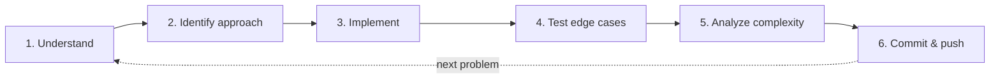

<div align="center">

# 🧠 DSA JOURNEY

**Learn → Implement → Analyze**


```text
> SYSTEM   : Daily Algorithm Practice
> LANGUAGE : Python
> MODE     : Learn → Implement → Analyze
> STATUS   : ACTIVE ●
```

</div>

---

## 📖 `/about`

A daily journey to build strong **Data Structures and Algorithms** fundamentals through consistent practice, implementation, debugging, and problem-solving.

> The goal is not just to solve problems, but to understand the logic behind them and learn to approach unfamiliar problems independently.

---

## 🎯 `/objectives`

| | Objective |
|:-:|---|
| 🧩 | Build strong problem-solving fundamentals |
| ⏱️ | Understand time and space complexity |
| 🏗️ | Implement data structures from scratch |
| 🔍 | Recognize patterns and choose appropriate approaches |
| 🟩 | Maintain a consistent GitHub contribution history |
| 📈 | Track mistakes, improvements, and progress |

---

## 🛠️ `/tech-stack`

| Category | Tool |
|---|---|
| **Language** | Python |
| **Platform** | LeetCode / DSA practice |
| **Version Control** | Git & GitHub |

---

## 🗺️ `/learning-path`

```mermaid
flowchart LR
    A[Arrays] --> B[Strings] --> C[Hash Maps]
    C --> D[Sliding Window] --> E[Two Pointers]
    E --> F[Sorting & Binary Search] --> G[Stack & Queue]
    G --> H[Linked Lists] --> I[Trees & Graphs] --> J[Dynamic Programming]

    classDef progress fill:#2ea44f,stroke:#1a7f37,color:#fff
    classDef learning fill:#f0ad4e,stroke:#c77c0e,color:#000
    classDef upcoming fill:#6e7781,stroke:#424a53,color:#fff
    class A,B,C progress
    class D,E learning
    class F,G,H,I,J upcoming
```



| Topic | Progress | Status |
|---|---|---|
| Arrays | `██████░░░░` | 🟢 In progress |
| Strings | `█████░░░░░` | 🟢 In progress |
| Hash Maps | `████░░░░░░` | 🟢 In progress |
| Sliding Window | `██░░░░░░░░` | 🟡 Learning |
| Two Pointers | `██░░░░░░░░` | 🟡 Learning |
| Sorting & Binary Search | `░░░░░░░░░░` | ⚪ Upcoming |
| Stack & Queue | `░░░░░░░░░░` | ⚪ Upcoming |
| Linked Lists | `░░░░░░░░░░` | ⚪ Upcoming |
| Trees & Graphs | `░░░░░░░░░░` | ⚪ Upcoming |
| Dynamic Programming | `░░░░░░░░░░` | ⚪ Upcoming |

---

## 📅 `/daily-log`

Problems are added daily with their implementations and relevant notes.

| Day | Problems | Topics |
|:-:|---|---|
| Day 01 → | Daily submissions | Arrays, strings, hashing, and more |

*The log will be updated as new problems are completed.*

---

## 📂 `/repository-structure`

```text
DSA-Journey/
├── 📁 Arrays/
├── 📁 Strings/
├── 📁 Hashing/
├── 📁 Sliding_Window/
├── 📁 Two_Pointers/
├── 📁 Sorting/
├── 📁 Binary_Search/
├── 📁 Stack_Queue/
├── 📁 Linked_List/
├── 📁 Trees/
├── 📁 Graphs/
├── 📁 Dynamic_Programming/
└── 📄 README.md
```

---

## 🔄 `/workflow`



---

## 🧭 `/principles`

- ✅ Consistency over intensity
- ✅ Understand before memorizing
- ✅ Debug mistakes instead of hiding them
- ✅ Prefer clear logic over unnecessary complexity
- ✅ Learn to solve independently, one problem at a time

---

## 💬 `/commit-convention`

```bash
git add .
git commit -m "solve: array problem 079"
git push
```

---

## 🚀 `/current-status`

> **Mission:** Become confident in solving DSA problems independently.
>
> **Rule:** Every problem is an opportunity to improve reasoning, not just increase the solved count.

```text
> END OF FILE
> NEXT ACTION: KEEP SOLVING.
```
