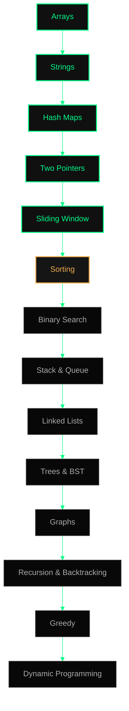

# DSA Journey

```text
┌───────────────────────────────────────────────┐
│                                               │
│             D S A   J O U R N E Y             │
│                                               │
│        LEARN  ->  IMPLEMENT  ->  ANALYZE       │
│                                               │
└───────────────────────────────────────────────┘
```


```text
┌─ SYSTEM STATUS ─────────────────────────────────
│  LANGUAGE : Python
│  MODE     : Learn -> Implement -> Analyze
│  ROUTINE  : 3 problems per study day
│  PROGRESS : Problem 171 completed
│  STATUS   : ● ACTIVE
└─────────────────────────────────────────────────
```

**Theme:** Black terminal aesthetic with monospace panels, black badges, and green accents. GitHub controls the actual page background through the viewer's theme.

---

## `01 / ABOUT`

A daily practice repository for building strong **Data Structures and Algorithms (DSA)** fundamentals using Python.

The objective is not simply to increase the solved count. It is to understand the logic, debug mistakes, recognize patterns, analyze complexity, and solve unfamiliar problems independently.

```text
$ objective
> Build reasoning, not memorized code.
```

## `02 / OBJECTIVES`

| ID | Objective |
|---|---|
| `[01]` | Strengthen problem-solving fundamentals |
| `[02]` | Understand time and space complexity |
| `[03]` | Implement data structures from scratch |
| `[04]` | Recognize patterns and choose suitable approaches |
| `[05]` | Test edge cases and debug mistakes |
| `[06]` | Maintain a consistent GitHub contribution history |
| `[07]` | Improve independent problem-solving |
| `[08]` | Learn algorithms through implementation and revision |

## `03 / TECH STACK`

```text
LANGUAGE         Python
PRACTICE         DSA problems / LeetCode-style exercises
VERSION CONTROL  Git
REMOTE           GitHub
```

## `04 / LEARNING PATH`



### Topic Progress

| Topic | Status | Focus |
|---|---|---|
| Arrays | `PRACTICED` | Loops, conditions, array patterns |
| Strings | `PRACTICED` | Character operations, substrings |
| Hash Maps | `PRACTICED` | Frequency counting, lookup |
| Two Pointers | `PRACTICED` | Pair finding, pointer movement |
| Sliding Window | `PRACTICED` | Fixed and variable-size windows |
| Sorting | `INTRODUCED` | Bubble, Selection, Insertion Sort |
| Binary Search | `UPCOMING` | Search in sorted arrays |
| Stack & Queue | `UPCOMING` | LIFO and FIFO |
| Linked Lists | `UPCOMING` | Nodes, traversal, operations |
| Trees & BST | `UPCOMING` | Traversal and tree operations |
| Graphs | `UPCOMING` | Traversal and graph algorithms |
| Recursion & Backtracking | `UPCOMING` | Recursive problem-solving |
| Greedy | `UPCOMING` | Local optimal choices |
| Dynamic Programming | `UPCOMING` | Overlapping subproblems |

*Sorting has been introduced, but still requires practice and revision.*

## `05 / DAILY LOG`

Each study day follows a structured routine:

- 2 problems from the current topic.
- 1 revision problem from a previously covered topic.
- Problems are attempted one at a time.
- Solutions are reviewed for correctness and complexity.

| Date | Problems | Topics / Notes |
|---|---:|---|
| 2026-10-18 | 7 | Strings, sets, frequency maps, unique/repeated characters, Sliding Window |
| 2026-11-04 | 3 | Insertion Sort, Merge Two Sorted Arrays, Valid Anagram |
| 2026-11-05 | 3 | Minimum Size Subarray Sum, Longest Subarray with Sum at Most K, Bubble Sort revision |

### Latest Session: 2026-11-05

```text
┌─ SESSION REPORT ─────────────────────────────────
│  PROBLEM 169 : Minimum Size Subarray Sum
│  TOPIC       : Sliding Window
│  RESULT      : SOLVED WITH GUIDANCE
│
│  PROBLEM 170 : Longest Subarray with Sum at Most K
│  TOPIC       : Sliding Window
│  RESULT      : SOLVED WITH GUIDANCE
│
│  PROBLEM 171 : Bubble Sort
│  TOPIC       : Sorting
│  RESULT      : SOLVED INDEPENDENTLY
│
│  COMPLETION  : 3 / 3
└─────────────────────────────────────────────────
```

*Session counts include problems completed with guidance. Problem numbers represent this repository's practice sequence, not necessarily official LeetCode submission counts.*

## `06 / REPOSITORY STRUCTURE`

```text
DSA-Journey/
│
├── Arrays/
├── Strings/
├── Hashing/
├── Two_Pointers/
├── Sliding_Window/
├── Sorting/
├── Binary_Search/
├── Stack_Queue/
├── Linked_List/
├── Trees/
├── Graphs/
├── Recursion_Backtracking/
├── Greedy/
├── Dynamic_Programming/
│
└── README.md
```

## `07 / WORKFLOW`

```text
[01] UNDERSTAND THE PROBLEM
          |
          v
[02] IDENTIFY AN APPROACH
          |
          v
[03] IMPLEMENT IN PYTHON
          |
          v
[04] TEST EDGE CASES
          |
          v
[05] ANALYZE TIME & SPACE
          |
          v
[06] REVIEW AND DEBUG
          |
          v
[07] COMMIT & PUSH
          |
          └──────────────> NEXT PROBLEM
```

## `08 / DAILY RULES`

```text
[01] Exactly 3 problems per study day.
[02] 2 problems from the current topic.
[03] 1 problem from a previous topic.
[04] Solve one problem at a time.
[05] Attempt independently before requesting hints.
[06] Review mistakes and complexity.
[07] Stop after completing the third problem.
```

## `09 / PRINCIPLES`

```text
[+] Consistency over intensity
[+] Understand before memorizing
[+] Debug mistakes instead of hiding them
[+] Prefer clear logic over unnecessary complexity
[+] Learn independently, one problem at a time
[+] Use hints to develop reasoning, not skip it
[+] Focus on problem-solving, not just solved counts
```

## `10 / GIT WORKFLOW`

```bash
git add .
git commit -m "solve: describe the problem"
git push origin main
```

Example:

```bash
git add .
git commit -m "solve: minimum size subarray sum"
git push origin main
```

## `11 / CURRENT MISSION`

```text
┌─ MISSION ───────────────────────────────────────
│
│  Become confident at solving DSA problems
│  independently.
│
│  CURRENT POSITION
│  Problem 171 completed.
│
│  CURRENT FOCUS
│  Strengthen Sliding Window and revise Sorting.
│
│  NEXT MILESTONE
│  Build a strong foundation before moving
│  into Binary Search and new data structures.
│
│  RULE
│  Every problem improves reasoning, not just
│  the solved count.
│
└─────────────────────────────────────────────────
```

```text
$ exit
[ SESSION ACTIVE ]
```
